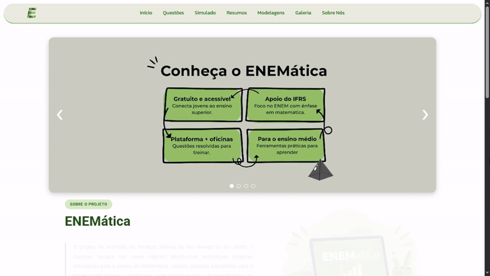
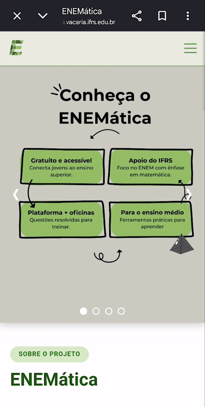
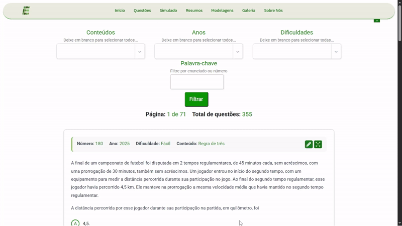
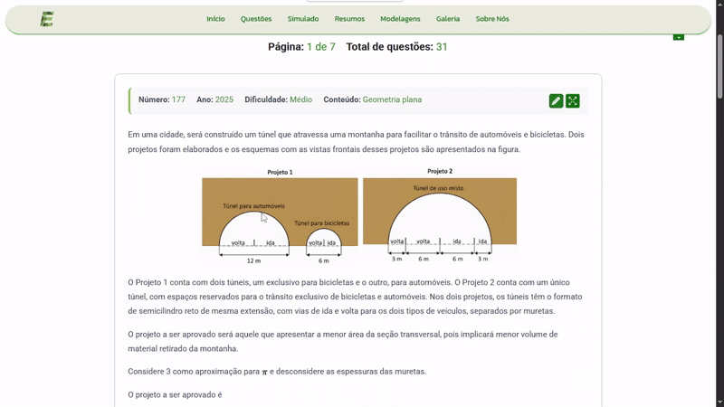
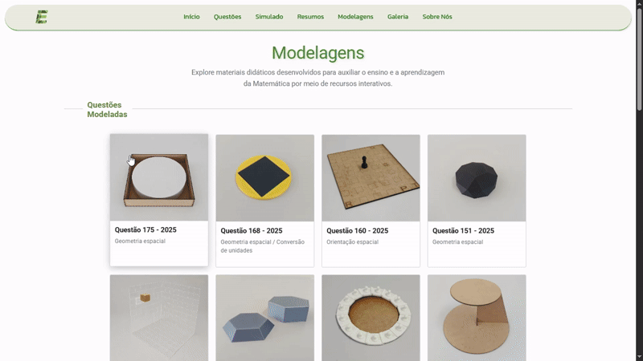
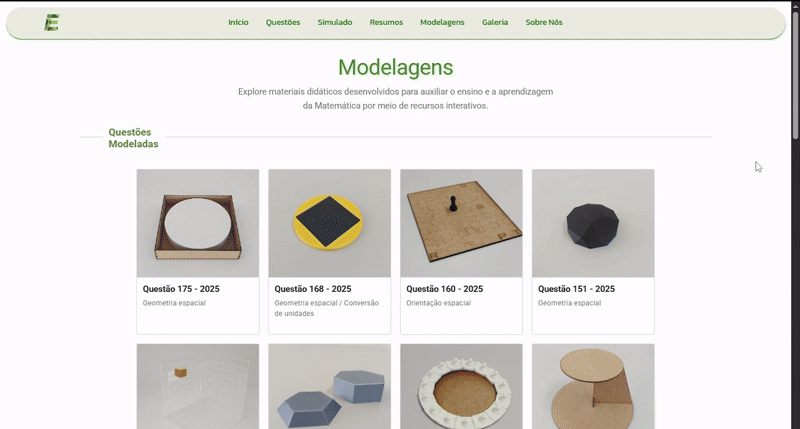

<div align="center">

# ENEMática

**Mathematics education platform focused on ENEM preparation**

[](https://enematica.vacaria.ifrs.edu.br/)
[](https://github.com/enematica/ENEMatica)


[Visit the platform](https://enematica.vacaria.ifrs.edu.br/) · [View source code](https://github.com/enematica/ENEMatica)

🌐 **English** | [Português (Brasil)](README.pt-BR.md)

</div>

> **Note:** ENEM (Exame Nacional do Ensino Médio) is Brazil's national high school exam, used for admission to universities. The platform and its content are in Brazilian Portuguese.

---

## About the project

**ENEMática** is an educational platform developed and maintained by scholarship students at **IFRS Campus Vacaria** (Federal Institute of Rio Grande do Sul, Brazil), focused on studying Mathematics and preparing for the ENEM. It goes beyond a simple question bank: a single web application brings together question solving with filters, commented video lessons, timed practice tests, summaries, mathematical models, and other educational materials.

The application is built with **Python and Django** on the backend and **HTML, CSS, and JavaScript** on the frontend, with a responsive interface and interactive features such as a digital scratchpad, expandable questions, and a countdown timer for practice tests. The project is running in production and its source code is public.

---

## Key features

| Feature | Description |
| --- | --- |
| **Question bank** | Browsing and solving ENEM Mathematics questions, from 2018 to 2025 |
| **Filters** | Filtering by topic, year, difficulty, and search by statement text or number |
| **Pagination** | Paginated listing for easier navigation |
| **Video lessons** | Commented video lessons linked to questions |
| **Digital scratchpad** | Drawing area for calculations and notes while solving |
| **Expanded questions** | Enlarged question view for easier reading |
| **Practice tests** | Custom tests by topic, year, and difficulty, with time control |
| **Summaries** | Mind maps and summaries of the main Mathematics topics |
| **Modelagens** | Modeled questions, modeled figures, and mathematical games |
| **Downloads** | Files available for download on the Modelagens pages |
| **Responsiveness** | Interface adapted to different screen sizes |

---

## Demo

### Home page: desktop and mobile

<p align="center">
  
</p>

<p align="center">
  
</p>

The home page presents the main navigation, the project's visual identity, highlights, and quick access cards. On mobile, the navigation and layout rearrange themselves for smaller screens.

---

## Question bank

Questions are one of the core features of ENEMática. The page gathers ENEM Mathematics questions in an interface with filters, pagination, video lessons, expansion, and an integrated scratchpad.

### Filters

Users can combine different criteria to find the questions they want:

* **Topic:** selection of one or more Mathematics topics
* **Year:** ENEM editions available on the platform
* **Difficulty:** easy, medium, and hard
* **Statement:** search by statement text or question number



The GIF shows a search by topic: the user selects a Mathematics topic and the list updates with the matching questions.

### Pagination

Questions are displayed in pages, which keeps the interface organized even with a large number of items.

### Answering questions

Users pick an answer choice and get immediate feedback. The GIF shows both cases: a **correct** answer and a **wrong** one, so you can see how the platform responds to each. At the end, it points the user to the commented video lesson.


### Video lessons

Some questions provide access to a commented video lesson that complements the solution. The end of the GIF above shows how to open it after answering.

### Question expansion

Each question can be enlarged, making the statement, figures, and answer choices easier to read.

### Digital scratchpad

An integrated tool lets users make calculations and notes without leaving the page. It offers:

* pen
* eraser
* color selection
* stroke width adjustment
* undo
* redo
* clear



---

## Practice tests

ENEMática has a dedicated area for practice through tests. Users build their own test by choosing:

* topics, years, and difficulty levels
* number of questions
* time per question

After the test is generated, the page shows a countdown timer to track time, the questions to solve, and the test completion step. The experience reuses concepts from the question page, such as how answer choices are displayed and the use of the scratchpad.

<!-- If you want, add a static image of the practice test page:

-->

---

## Modelagens

The **Modelagens** page (mathematical models) is an area dedicated to Mathematics teaching resources. It includes ENEM questions linked to physical models and three-dimensional representations, as well as figures and games. Each item has a details page with photos, a description, and, when available, a file to download.

### Page overview

The GIF below scrolls through the whole Modelagens page, showing each of its sections.



### Item details

The flow shown is: **explore, open, view, and download**.

1. The user browses the available models
2. Opens the details page of an item
3. Views the original question and the model images
4. Downloads the model file using the download button



### Categories

| Category | Description |
| --- | --- |
| **Modeled questions** | ENEM questions accompanied by models that help visualize the problem, with topics such as solid geometry, orthogonal projection, and spatial orientation |
| **Modeled figures** | Geometric solids such as cube, sphere, cone, cylinder, prisms, and pyramids, with defined measurements |
| **Mathematical games** | Games that encourage logical reasoning and spatial perception |

These resources serve both students and teachers. On the details pages of modeled questions, the project describes the processes used to build the pieces, such as **3D printing** and **laser cutting**, and explains how to use the downloaded file to produce your own physical model.

---

## Summaries

The summaries page gathers mind maps and visual materials on Mathematics topics, such as percentages, ratio and proportion, fraction operations, and statistics, with an enlarged image viewer.

---

## Responsive design

The interface was developed to adapt to different devices:

* Desktop
* Laptop
* Tablet
* Smartphone

Elements such as navigation, cards, grids, images, spacing, and content layout adjust to the screen size. The home page GIFs in the demo section illustrate this adaptation between desktop and mobile.

---

## Technologies

| Technology | Usage |
| --- | --- |
| **Python** | Main backend language |
| **Django 5.2** | Web framework and application structure |
| **HTML** | Page structure |
| **CSS** | Styling and responsive layouts |
| **JavaScript** | Interactivity and dynamic features |
| **django-ckeditor** | Rich content editing, such as formatted statements |
| **Pillow** | Image processing for files uploaded to the platform |
| **python-dotenv** | Environment variable loading |
| **Git** | Version control |
| **GitHub** | Code hosting and versioning |

Python dependencies are listed in [`requirements.txt`](requirements.txt).

---

## Architecture and organization

The project uses **Django** to structure the web application, following the framework's separation of concerns:

* **Models:** define the entities and the database schema, such as questions, topics, models, and their files
* **Views:** hold the logic of each page, including filters, pagination, test generation, and downloads
* **Templates:** define the HTML layer rendered to the user
* **URLs:** map each site route to its corresponding view
* **Static files:** gather the frontend CSS, JavaScript, and images
* **Database:** stores the platform's content, accessed through Django's ORM

The result is a structure organized into Django apps, templates, and static files, with backend and frontend separated by responsibility.

---

## Project structure

```text
ENEMatica/
├── app/
├── enematica/
├── imagens/
├── materiais_apoio/
├── static/
├── templates/
├── LICENSE
├── manage.py
└── requirements.txt
```

| Item | Description |
| --- | --- |
| `app/` | Project's Django application |
| `enematica/` | Django project settings |
| `imagens/` | Image resources of the repository |
| `materiais_apoio/` | Internal implementation of the **Modelagens** page resources |
| `static/` | Static files (CSS, JavaScript, and images) |
| `templates/` | HTML templates |
| `manage.py` | Django management utility |
| `requirements.txt` | Python dependencies |
| `LICENSE` | Apache 2.0 license |

> `materiais_apoio` is only the internal name of the app. For users, the page is called **Modelagens**.

---

## Interactivity

JavaScript implements the frontend's interactive logic, going beyond what HTML and CSS alone can do. Features include:

* question filters
* navigation and pagination interactions
* modals and enlarged image viewing
* practice test countdown timer
* question expansion
* scratchpad tool
* interface controls
* responsive navigation

---

## Running locally

### Prerequisites

* Python 3.10 or higher
* Git

### 1. Clone the repository

```bash
git clone https://github.com/enematica/ENEMatica.git
cd ENEMatica
```

### 2. Create and activate a virtual environment

**Windows (PowerShell):**

```powershell
python -m venv venv
venv\Scripts\Activate.ps1
```

**Linux and macOS:**

```bash
python3 -m venv venv
source venv/bin/activate
```

### 3. Install dependencies

```bash
pip install -r requirements.txt
```

### 4. Configure environment variables

The project reads its sensitive settings from a `.env` file, using `python-dotenv`. Create the file in the project root (next to `manage.py`) from the template:

**Windows (PowerShell):**

```powershell
Copy-Item .env.example .env
```

**Linux and macOS:**

```bash
cp .env.example .env
```

Then fill in the values in `.env`.

### 5. Apply migrations

```bash
python manage.py migrate
```

### 6. Start the development server

```bash
python manage.py runserver
```

The application will be available at `http://127.0.0.1:8000/`.

### Optional: create a superuser

To access the Django admin panel:

```bash
python manage.py createsuperuser
```

---

## Environment variables

Variables live in the `.env` file, which **must not be versioned**. The repository includes the [`.env.example`](.env.example) template, with no real values.

```dotenv
SECRET_KEY=
DEBUG=
```

| Variable | Description | Development example |
| --- | --- | --- |
| `SECRET_KEY` | Django secret key, used to sign sessions, cookies, and tokens. It must be unique, long, and kept private | Value generated by the command below |
| `DEBUG` | Enables or disables Django's debug mode | `True` |

### Generating a `SECRET_KEY`

```bash
python -c "from django.core.management.utils import get_random_secret_key; print(get_random_secret_key())"
```

Copy the generated value into `.env`.

### Best practices

* Never commit the `.env` file to the repository. Make sure it is listed in `.gitignore`.
* Use a different `SECRET_KEY` for each environment (development and production).
* In production, keep `DEBUG=False`. With debug mode on, Django may expose internal application details on error pages.
* If a key is exposed by mistake, generate a new one and replace the old one.

---

## Open source

ENEMática's source code is publicly available on GitHub under the **Apache 2.0** license:

https://github.com/enematica/ENEMatica

This allows anyone interested to:

* read the code
* study its implementation
* follow the project's evolution
* understand the architecture
* review the technologies used

---

## Production deployment

ENEMática has a public version, accessible over the internet:

https://enematica.vacaria.ifrs.edu.br/

It is not a local prototype, but an application made publicly available for use.

---

## Institutional support

ENEMática is developed within the **Federal Institute of Education, Science and Technology of Rio Grande do Sul (IFRS) - Campus Vacaria**, as an extension project, and has the institutional support of IFRS.

The coordinator and scholarship students can be found on the platform's [Sobre Nós](https://enematica.vacaria.ifrs.edu.br/sobre-nos/) (About Us) page.

---

## Recognition

🏆 **1st place at MOSTRATEC**, in the area of Planetary and Terrestrial Sciences, Mathematics and Physics.

🏆 **3rd place at FENADANTE**, in the area of Exact Sciences.

---

## Purpose

ENEMática aims to support the study and teaching of Mathematics, especially in the context of the ENEM. To do so, it brings together in one place:

* practice
* questions
* video lessons
* practice tests
* digital tools
* mathematical models
* educational materials

---

## Get started

**Platform:**
https://enematica.vacaria.ifrs.edu.br/

**Source code:**
https://github.com/enematica/ENEMatica

Explore the platform and feel free to browse the source code.
